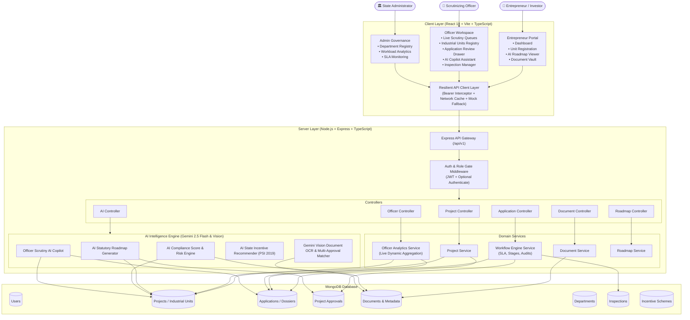
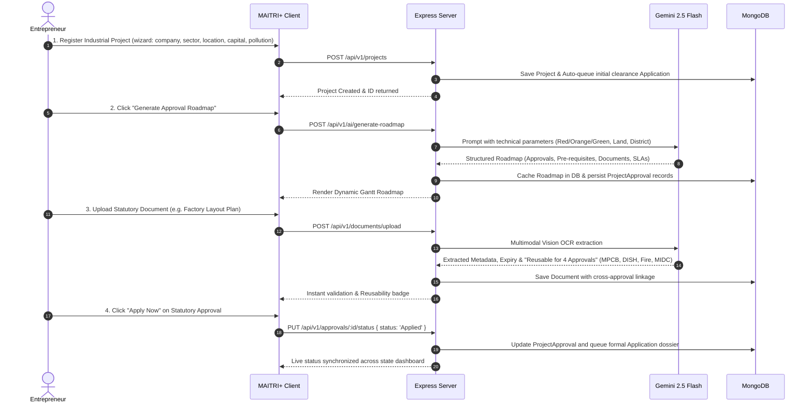
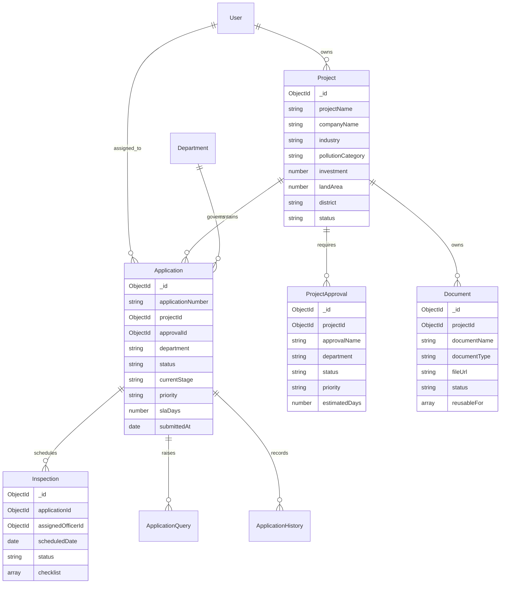

# MAITRI+ (Maharashtra AI-powered Industrial Registration & Tracking Intelligence)
### Smart India Hackathon (SIH) — Problem Statement PS-26130
> **Theme:** Single-Window Clearance Portal, AI Regulatory Compliance & Government Officer Scrutiny Workspace for Industrial Enterprises in Maharashtra.

---

## 📑 Table of Contents
1. [System Overview & Architecture](#-system-overview--architecture)
2. [End-to-End Architectural Flow Diagram](#-end-to-end-architectural-flow-diagram)
3. [User Persona Workflows](#-user-persona-workflows)
   - [1. Entrepreneur Journey](#1-entrepreneur-journey)
   - [2. Government Officer Scrutiny Workflow](#2-government-officer-scrutiny-workflow)
   - [3. Departmental & State Administration](#3-departmental--state-administration)
4. [AI Intelligence Engines (Powered by Google Gemini 2.5 Flash)](#-ai-intelligence-engines-powered-by-google-gemini-25-flash)
5. [Frontend Client Architecture](#-frontend-client-architecture)
6. [Backend Service Layer & Database Schemas](#-backend-service-layer--database-schemas)
7. [API Route Catalog](#-api-route-catalog)
8. [Installation & Setup](#-installation--setup)

---

## 🏛️ System Overview & Architecture

MAITRI+ is an enterprise-grade Single Window Clearance System (SWCS) that digitizes, automates, and accelerates statutory clearance procedures for industrial setups across Maharashtra state departments:
- **MPCB** — Maharashtra Pollution Control Board (Consent to Establish / Operate)
- **DISH** — Directorate of Industrial Safety & Health (Factory License & Plan Sanctions)
- **DMFS** — Directorate of Maharashtra Fire Services (Provisional & Final Fire NOCs)
- **MIDC** — Maharashtra Industrial Development Corporation (Plot & Water Pipeline Allotment)
- **MSEDCL** — Maharashtra State Electricity Distribution Co. (HT Substation Power Sanctions)
- **Labour Commissionerate** — Contract Labour Regulation & Standing Orders

The platform is designed with an **isolated, resilient MERN architecture**:
- **Client**: React 18, Vite, TypeScript, TailwindCSS, TanStack React Query, Lucide Icons, Recharts.
- **Server**: Node.js, Express, TypeScript, Mongoose ODM, JWT Authentication, Multer file handling.
- **AI Core**: Google Gemini 2.5 Flash & Gemini 2.5 Vision for dynamic roadmaps, compliance scoring, document reuse OCR, scheme matchmaking, and officer copilot assistance.
- **Database**: MongoDB with strict indexing, schema validation, and audit histories.

---

## 🔄 End-to-End Architectural Flow Diagram



---

## 👥 User Persona Workflows

### 1. Entrepreneur Journey



### 2. Government Officer Scrutiny Workflow

```mermaid
sequenceDiagram
    autonumber
    actor Off as Scrutinizing Officer
    participant UI as Officer Workspace
    participant Server as Express Server
    participant Copilot as Gemini AI Copilot
    participant DB as MongoDB

    Off->>UI: 1. Open Officer Workspace (/officer)
    UI->>Server: GET /api/v1/officer/dashboard-analytics
    Server->>DB: Live aggregation of applications, SLA countdowns, priority queues
    Server-->>UI: Real-time 12 KPIs, Workload Distribution, Priority Queues

    Off->>UI: 2. Browse "Industrial Units" (/projects) & "Approvals Pipeline" (/applications)
    UI->>Server: GET /api/v1/applications?status=Submitted
    Server-->>UI: Live list of submitted applications sorted by submission date

    Off->>UI: 3. Open Application Scrutiny Drawer & click "Ask AI Copilot"
    UI->>Server: POST /api/v1/ai/copilot/action { action: 'scrutinize_summary' }
    Server->>Copilot: Analyze submitted dockets, drawings, land zoning & EIA limits
    Copilot-->>Server: Structured risk score, missing items, and scrutiny remarks
    Server-->>UI: Display real-time AI Scrutiny Dossier

    Off->>UI: 4. Officer Action: Schedule Joint Field Inspection
    UI->>Server: POST /api/v1/applications/:id/inspection
    Server->>DB: Save Inspection record with compliance checklist & notify applicant

    Off->>UI: 5. Officer Action: Grant Clearance & Issue Digital NOC
    UI->>Server: PATCH /api/v1/applications/:id/status { status: 'Approved' }
    Server->>DB: Transition status, issue certificate number & log tamper-evident audit history
    Server-->>UI: Application approved; live KPI counters updated instantaneously
```

### 3. Departmental & State Administration
- **Department Registry**: Real-time listing of active state clearance authorities with SLA benchmarks and active nodal officers.
- **Officer Workload Rebalancing**: State administrators reassign stalled dossiers between officers to prevent SLA breaches.
- **RTS (Right to Services) SLA Monitoring**: Automatic countdown timers mark applications as `Approaching Deadline` (<= 3 days) or `Overdue`, triggering escalation alerts.

---

## 🧠 AI Intelligence Engines (Powered by Google Gemini 2.5 Flash)

| Engine | Endpoint | Gemini Model | Functionality |
|---|---|---|---|
| **AI Approval Roadmap** | `POST /api/v1/ai/generate-roadmap` | `gemini-2.5-flash` | Analyzes capital, district, pollution category, and process to generate statutory clearance sequences, parallel tracks, and time estimates. |
| **AI Compliance Score** | `POST /api/v1/ai/compliance-score` | `gemini-2.5-flash` | Calculates 0–100% compliance health, identifying missing licenses, environmental risks, and actionable recommendations. |
| **AI Smart Document OCR** | `POST /api/v1/ai/analyze-document` | `gemini-2.5-flash` (Vision) | Performs deep visual OCR on uploaded PDFs/drawings, extracts issue dates, and identifies cross-department document reuse. |
| **AI Scheme Matchmaker** | `POST /api/v1/ai/recommend-schemes` | `gemini-2.5-flash` | Matches units to state subsidies (Package Scheme of Incentives 2019, CMEGP, Ambedkar Special Scheme) with exact financial benefits. |
| **AI Officer Copilot** | `POST /api/v1/ai/copilot/action` | `gemini-2.5-flash` | Assists clearance officers with automated technical scrutiny summaries, query drafting, checklist generation, and risk evaluations. |

---

## 💻 Frontend Client Architecture

The frontend follows a domain-driven component architecture:

```
client/src/
├── api/                        # Resilient API Client & Mock fallback layer
│   ├── client.ts               # Axios instance with auth token injection & resilient fallback
│   ├── project.api.ts          # Industrial units registry API
│   ├── application.api.ts      # Clearance application pipeline API
│   ├── dashboard.api.ts        # Officer workspace live metrics API
│   └── mockData/               # Graceful fallback JSON fixtures
├── components/                 # Atomic UI library
│   ├── Navbar.tsx              # Top navigation with role switcher & user profile
│   ├── Sidebar.tsx             # Collapsible responsive sidebar with role gates
│   ├── AICopilotDrawer.tsx     # Slide-over AI copilot panel with live context
│   ├── StatusBadge.tsx         # Color-coded regulatory status indicators
│   └── common/                 # Reusable cards, drawers, modals, timelines
├── context/
│   ├── AuthContext.tsx         # JWT token management & 1-click persona switching
│   ├── OfficerContext.tsx      # Global officer portal state & quick filters
│   └── ThemeContext.tsx        # Dark / Light theme persistence
├── pages/
│   ├── entrepreneur/           # Entrepreneur Dashboard & Unit Tracker
│   ├── projects/               # Industrial Units Registry, Multi-step Creation Wizard
│   ├── roadmap/                # Interactive Gantt AI Approval Roadmap
│   ├── documents/              # Smart Document Vault with OCR verification
│   ├── officer/                # Nodal Officer Workspace, Queues, Workload & Inspections
│   ├── applications/           # Industrial Approvals pipeline & review drawers
│   └── compliance/             # AI Compliance Audit & Action Plan Tracker
└── services/                   # HTTP service integrations (api.ts)
```

---

## 🗄️ Backend Service Layer & Database Schemas

### Core MongoDB Models



---

## 📡 API Route Catalog

### 1. Projects & Industrial Units (`/api/v1/projects`)
- `GET /` — Search, filter, sort and paginate registered industrial units.
- `POST /` — Register new industrial unit and auto-queue clearance application.
- `GET /:id` — Detailed project profile with ownership and infrastructure metrics.
- `PUT /:id` — Update project specifications.
- `DELETE /:id` — Soft-delete industrial unit docket.

### 2. Clearance Applications (`/api/v1/applications`)
- `GET /` — Full scrutiny pipeline with department, status, priority, and date filters.
- `POST /` — Submit a statutory application dossier.
- `GET /:id` — Detailed dossier with linked documents, inspections, queries, and audits.
- `PATCH /:id/status` — Transition application status (`Under Scrutiny`, `Approved`, `Rejected`).
- `PATCH /:id/query` — Raise officer query or submit applicant clarification response.
- `PATCH /:id/assign` — Assign or reassign dossier to a departmental officer.
- `POST /:id/inspection` — Schedule physical / joint field inspection with checklist.

### 3. Officer Workspace (`/api/v1/officer`)
- `GET /dashboard-analytics` — Live aggregated KPIs (pending reviews, average SLA, deadline risk, queue counts).
- `GET /workload` — Per-officer caseload, clearance rate, and SLA adherence.
- `GET /inspections` — Scheduled inspections registry across departments.
- `GET /departments` — Active regulatory department roster.
- `POST /export` — Export officer registries to CSV.

### 4. AI Intelligence Suite (`/api/v1/ai`)
- `POST /generate-roadmap` — Gemini 2.5 Flash statutory approval roadmap generation.
- `GET /roadmap/:projectId` — Retrieve cached statutory roadmap for an enterprise.
- `POST /compliance-score` — Calculate dynamic 0–100% compliance health & risk level.
- `POST /analyze-document` — Gemini Vision multimodal document analysis & reuse matcher.
- `POST /recommend-schemes` — State industrial incentives & subsidy matchmaking.
- `POST /copilot/action` — Scrutiny copilot actions (`scrutinize_summary`, `draft_query`, `inspection_checklist`).

---

## 🚀 Installation & Setup

### Prerequisites
- **Node.js** >= 18.0.0
- **MongoDB** running locally at `mongodb://127.0.0.1:27017` or MongoDB Atlas URI
- **Google Gemini API Key** (optional for local fallback; required for live generative AI features)

### 1. Backend Server Setup
```bash
cd server
npm install

# Configure environment variables in server/.env
cp .env.example .env

# Seed initial regulatory data & demo accounts
npm run seed

# Start server development daemon
npm run dev
```
- Server endpoint: **`http://localhost:5000`**
- Health check: **`http://localhost:5000/api/v1/health`**

### 2. Frontend Client Setup
```bash
cd client
npm install

# Start Vite dev server
npm run dev
```
- Client portal: **`http://localhost:5173`**

### 3. Pre-configured Demo Personas
Use the built-in Persona Switcher in the top navigation bar to test all user journeys:
- **Entrepreneur**: `raj@industries.com` / `12345678`
- **Nodal Officer**: `officer@maitri.com` / `12345678`
- **Administrator**: `admin@maitri.com` / `12345678`
